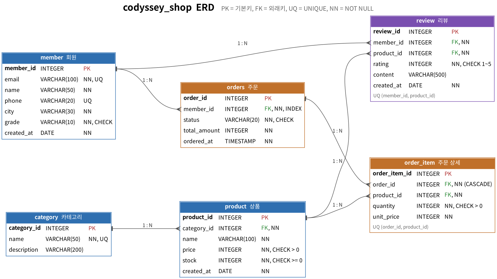

# codyssey_B6_1 · 전자상거래 데이터베이스 실습 (PostgreSQL)

회원이 상품을 주문하고 리뷰를 남기는 **전자상거래 도메인**을 6개 테이블로 설계하고,
스키마 생성 → 샘플 데이터 입력 → 핵심 쿼리 20개 실행까지 순수 SQL로 진행한 결과물입니다.
(백엔드 프레임워크 없음 · 결과 저장용 Python 스크립트는 PostgreSQL 기본 클라이언트 `psql`만 호출)

---

## 1. 제출물 구성

```text
codyssey_B6_1/
├── README.md               ← 과제 설명 · 개념 답변 · 쿼리별 실행 결과
├── sql/
│   ├── 01_schema.sql       ← 스키마 생성 (CREATE TABLE, PK/FK/제약조건)
│   ├── 02_sample_data.sql  ← 샘플 데이터 INSERT (부모 → 자식 순서)
│   └── 03_queries.sql      ← 핵심 쿼리 20개 (각 쿼리에 한 줄 설명)
├── results/                ← 실행 결과 캡처 폴더
│   ├── 00_table_counts.txt / .png   ← 테이블별 행 수
│   ├── Q01.txt ~ Q20.txt            ← 쿼리 + 결과 텍스트
│   ├── Q01.png ~ Q20.png            ← 결과 캡처 이미지
│   └── RESULTS.md                   ← 전체 결과 모음
├── erd/
│   ├── erd.png             ← ERD 다이어그램 이미지
│   └── erd.dot             ← ERD 원본 (Graphviz)
└── run_queries.py          ← 01 → 02 → 03 을 실행하고 results/ 와 README 결과를 만드는 스크립트
```

| 요구 제출물 | 파일 |
|---|---|
| 스키마 생성 SQL 1개 | `sql/01_schema.sql` |
| 샘플 데이터 INSERT SQL 1개 | `sql/02_sample_data.sql` |
| 쿼리 15개 이상 SQL 1개 | `sql/03_queries.sql` (20개) |
| 실행 결과 캡처 폴더 1개 | `results/` (텍스트 + PNG) |
| ERD 이미지 1개 | `erd/erd.png` |

---

## 2. 실행 방법

### 2-1. 환경 준비
1. **PostgreSQL** 설치 (16 버전 기준으로 작성·검증). 설치 시 `postgres` 계정 비밀번호를 정해 둡니다.
2. **DBeaver** 설치 → `New Database Connection` → PostgreSQL → Host `localhost`, Port `5432`, User `postgres`.
3. 실습용 DB 생성: `CREATE DATABASE codyssey_shop;`

### 2-2. DBeaver(또는 psql)에서 직접 실행
`codyssey_shop` DB에 접속한 뒤 아래 순서대로 스크립트를 실행합니다. (DBeaver: 파일 열기 → `Alt+X` 스크립트 실행)

```text
01_schema.sql  →  02_sample_data.sql  →  03_queries.sql
```

psql 로는 다음과 같습니다.

```bash
psql -U postgres -d codyssey_shop -f sql/01_schema.sql
psql -U postgres -d codyssey_shop -f sql/02_sample_data.sql
psql -U postgres -d codyssey_shop -f sql/03_queries.sql
```

> `01_schema.sql` 은 맨 앞에서 기존 테이블을 지우므로 언제든 다시 실행해 처음 상태로 되돌릴 수 있습니다.
> `03_queries.sql` 의 Q15~Q17 은 데이터를 수정·삭제하므로, 다시 실습할 때는 01 → 02 부터 실행합니다.

### 2-3. Python 스크립트로 한 번에 실행하고 결과 저장

```bash
# 비밀번호는 --password 또는 환경변수 PGPASSWORD 로 전달
python run_queries.py --user postgres --password 비밀번호 --dbname codyssey_shop
```

- DB가 없으면 만들고, 01 → 02 를 실행한 뒤 03 의 쿼리를 `-- [Qnn]` 머리줄 단위로 하나씩 실행합니다.
- 결과는 `results/Qnn.txt`, `results/Qnn.png`(Pillow + 고정폭 한글 폰트가 있을 때), `results/RESULTS.md` 로 저장되고,
  이 README의 **6. 쿼리별 실행 결과** 구간도 자동으로 갱신됩니다.
- `psql` 이 PATH 에 없으면 `--psql "C:\Program Files\PostgreSQL\16\bin\psql.exe"` 처럼 경로를 지정합니다.
- 캡처 폰트는 Noto Sans Mono CJK / D2Coding / 나눔고딕코딩을 자동으로 찾으며, `--font` 로 직접 지정할 수 있습니다.

---

## 3. 데이터 모델 (ERD)



| 테이블 | 역할 | 행 수 | 주요 제약조건 |
|---|---|---|---|
| `member` | 회원 | 12 | PK, `email` NOT NULL + UNIQUE, `phone` UNIQUE, `grade` CHECK |
| `category` | 상품 카테고리 | 10 | PK, `name` UNIQUE |
| `product` | 상품 | 20 | PK, FK→category, `price > 0`, `stock >= 0` |
| `orders` | 주문 (ORDER는 예약어라 복수형) | 15 | PK, FK→member, `status` CHECK |
| `order_item` | 주문 상세(주문 1건에 담긴 상품들) | 27 | PK, FK→orders (ON DELETE CASCADE), FK→product, UNIQUE(order_id, product_id) |
| `review` | 상품 리뷰 | 17 | PK, FK→member, FK→product, `rating` 1~5, UNIQUE(member_id, product_id) |

**1:N 관계 (총 6개)**

| 부모 (1) | 자식 (N) | 의미 |
|---|---|---|
| member | orders | 회원 한 명은 여러 번 주문한다 |
| category | product | 카테고리 하나에 상품이 여러 개 속한다 |
| orders | order_item | 주문 한 건에 여러 상품이 담긴다 |
| product | order_item | 상품 하나는 여러 주문에 등장한다 |
| member | review | 회원 한 명이 리뷰를 여러 개 쓴다 |
| product | review | 상품 하나에 리뷰가 여러 개 달린다 |

`order_item` 은 `orders` 와 `product` 사이의 **N:M 관계를 두 개의 1:N 으로 풀어 주는 연결 테이블**이고,
주문 당시 가격(`unit_price`)을 따로 저장해 나중에 상품 가격이 바뀌어도 과거 주문 금액이 변하지 않게 했습니다.

**컬럼 타입 선택 기준**: 식별자·금액·수량은 `INTEGER`(원 단위 정수), 이름·이메일 등 길이 제한이 있는 문자열은 `VARCHAR(n)`,
가입일·작성일은 `DATE`, 주문 시각처럼 시간까지 필요한 값은 `TIMESTAMP`.

---

## 4. 요구사항 충족 확인

| 요구사항 | 충족 내용 | 위치 |
|---|---|---|
| 테이블 4개 이상, 각 테이블 PK | 6개 테이블, 모두 PK | `01_schema.sql` |
| FK로 1:N 관계 2개 이상 | FK 6개 / 1:N 6개 | `01_schema.sql`, ERD |
| NOT NULL 1개 이상 | `member.email`, `member.name`, `product.price` 등 다수 | `01_schema.sql` |
| UNIQUE 1개 이상 | `member.email`, `member.phone`, `category.name`, 복합 UNIQUE 2개 | `01_schema.sql` |
| FK 실제 동작 | 없는 회원(999)으로 주문 INSERT → 거부됨 | Q19 결과 |
| 테이블당 10행 이상, 부모 먼저 입력 | 12 / 10 / 20 / 15 / 27 / 17행, member·category → product → orders → order_item → review 순 | `02_sample_data.sql`, `results/00_table_counts.txt` |
| 기본 조회 4개 이상 (WHERE, ORDER BY, LIMIT) | Q01 ~ Q04 | `03_queries.sql` |
| 조인 4개 이상 (INNER 2+, LEFT 1+) | INNER: Q05, Q06 / LEFT: Q07, Q08 (+ Q09, Q10, Q12, Q14 에서도 INNER JOIN) | `03_queries.sql` |
| 집계 3개 이상 (COUNT/SUM/AVG 2종+ , GROUP BY) | Q09 ~ Q12 (COUNT, SUM, AVG 모두 사용) | `03_queries.sql` |
| 서브쿼리 1개 이상 | Q13 (스칼라), Q14 (IN), Q16 (상관 서브쿼리) | `03_queries.sql` |
| UPDATE / DELETE 2개 이상 | Q15, Q16 (UPDATE), Q17 (DELETE + CASCADE) | `03_queries.sql` |
| 인덱스 1개 이상 + 이유 1줄 | Q18 `idx_orders_member_id` + EXPLAIN 확인 | `03_queries.sql` |
| DB 전용 문법 주석 | `LIMIT`, `DROP INDEX IF EXISTS`, `SET enable_seqscan`, `EXPLAIN` 에 `[PostgreSQL 전용]` 주석 | `03_queries.sql` |
| 쿼리마다 한 줄 설명 + 결과 | `-- [Qnn] 범주 \| 설명` + 아래 6장 / `results/` | README, `results/` |

---

## 5. 과제 목표 답변

### 5-1. 데이터베이스는 엑셀과 무엇이 다른가? 왜 테이블을 나눠 저장하는가?

엑셀은 사람이 **보고 편집하기 위한 표**이고, 데이터베이스는 프로그램과 여러 사용자가 **동시에 안전하게 저장·검색하기 위한 저장소**입니다.

| 구분 | 엑셀 | 관계형 데이터베이스 |
|---|---|---|
| 규칙 강제 | 셀에 아무 값이나 입력 가능 | 타입, NOT NULL, UNIQUE, CHECK, FK 로 잘못된 값을 **입력 단계에서 거부** |
| 동시 사용 | 여러 명이 동시에 고치면 충돌 | 트랜잭션·잠금으로 동시에 수천 건 처리 |
| 데이터 양 | 약 100만 행이 한계, 커지면 느림 | 수억 행도 인덱스로 빠르게 검색 |
| 조회 방법 | 필터·VLOOKUP 등 수작업 | SQL 한 문장으로 조건·연결·집계 |
| 관계 | 시트 간 연결이 약하고 깨지기 쉬움 | PK/FK 로 테이블 간 관계를 보장 |

**테이블을 나누는 이유(정규화)**: 주문 시트 한 장에 회원 이름·이메일·상품명·가격을 매번 같이 적으면,
김민수 회원이 주문을 3번 할 때 이메일이 3번 중복 저장됩니다. 이메일이 바뀌면 3곳을 모두 고쳐야 하고 하나라도 빠뜨리면
데이터가 서로 모순됩니다(갱신 이상). 그래서 **회원 정보는 `member` 에 한 번만**, 주문에는 회원 번호(`member_id`)만 저장합니다.
이렇게 하면 중복이 사라지고, 한 곳만 고치면 모든 주문에 반영되며, 저장 공간도 줄어듭니다.

### 5-2. PK / FK 와 1:N 관계

- **PK(Primary Key, 기본키)**: 테이블 안에서 한 행을 **유일하게 식별**하는 컬럼. 중복될 수 없고 NULL 일 수 없습니다.
  예) `member.member_id` — 동명이인이 있어도 회원 번호로 정확히 한 명을 가리킵니다.
- **FK(Foreign Key, 외래키)**: 다른 테이블의 PK 를 **참조하는 컬럼**. 참조 대상이 실제로 있어야만 값을 넣을 수 있습니다.
  예) `orders.member_id` 는 `member.member_id` 를 참조 → 없는 999번 회원으로 주문하면 DB가 거부합니다(Q19 결과).
- **1:N 관계**: 부모 1행에 자식 여러 행이 연결되는 구조이며, **N 쪽(자식)에 FK 를 둡니다.**
  회원 1명(`member_id = 1`)에 주문 3건(`orders.member_id = 1` 인 행 3개)이 붙어 있는 식입니다.
  자식이 부모의 번호만 들고 있으므로, 필요할 때 JOIN 으로 "이 주문을 한 회원은 누구인가"를 다시 이어 붙일 수 있습니다.
  `ON DELETE CASCADE` 를 설정하면 부모(주문)를 지울 때 자식(주문 상세)도 함께 지워져 고아 데이터가 남지 않습니다(Q17).

### 5-3. SELECT / INSERT / UPDATE / DELETE 는 언제 쓰나

| 명령 | 언제 | 예시 (이 프로젝트) |
|---|---|---|
| `SELECT` | 데이터를 **읽기**만 할 때 (원본 변경 없음) | 상품 검색, 주문 내역 조회, 매출 통계 (Q01~Q14) |
| `INSERT` | **새 행을 추가**할 때 | 회원 가입, 주문 생성, 리뷰 작성 (`02_sample_data.sql`) |
| `UPDATE` | **기존 행의 값을 바꿀** 때 | 배송 상태 변경, 재고 차감 (Q15, Q16) |
| `DELETE` | **행 자체를 없앨** 때 | 취소 주문 정리 (Q17) |

UPDATE·DELETE 는 `WHERE` 를 빠뜨리면 **테이블 전체**가 바뀌거나 지워지므로, 먼저 같은 조건의 SELECT 로 대상 행을 확인하는 습관이 중요합니다
(Q16, Q17 에서 변경 전후를 SELECT 로 확인).

### 5-4. JOIN 과 GROUP BY 로 연결된 데이터를 한 번에 뽑기

- **JOIN**: 나눠 저장한 테이블을 **PK = FK 조건으로 다시 이어 붙여** 한 결과로 보여줍니다.
  - `INNER JOIN`: 양쪽에 모두 짝이 있는 행만. 예) Q06 — 회원 → 주문 → 주문상세 → 상품 → 카테고리 5개 테이블을 이어 "김민수가 산 상품 목록"을 한 번에 조회.
  - `LEFT JOIN`: 왼쪽 테이블은 짝이 없어도 모두 남기고 오른쪽 값은 NULL. 예) Q07 — 주문이 없는 회원 찾기, Q08 — 리뷰가 0개인 상품도 목록에 포함.
- **GROUP BY**: 같은 값끼리 묶어 묶음마다 `COUNT / SUM / AVG` 를 계산합니다. `HAVING` 은 묶은 **뒤의** 결과를 거르는 조건입니다(`WHERE` 는 묶기 **전** 행을 거름).
  - 예) Q10 — JOIN 으로 회원과 주문을 잇고, `GROUP BY 회원` 으로 회원별 총 구매액을 구한 뒤 `HAVING SUM >= 200000` 으로 우수 회원만 추출.

즉 **JOIN 으로 흩어진 데이터를 모으고, GROUP BY 로 요약**하는 것이 "연결된 데이터를 한 번에 뽑는" 기본 패턴입니다.

### 5-5. 실무 요구(검색 / 정렬 / 집계 / 랭킹)를 SQL로 푸는 법

| 실무 요구 | SQL 해법 | 예시 쿼리 |
|---|---|---|
| 검색 "무선 들어간 상품" | `WHERE name LIKE '%무선%'` | Q03 |
| 필터 "10월 주문, 취소 제외" | `WHERE` 범위 조건 + `AND` | Q04 |
| 정렬 "비싼 순 Top 5" | `ORDER BY price DESC LIMIT 5` | Q02 |
| 집계 "카테고리별 평균가", "월별 매출" | `GROUP BY` + `COUNT/SUM/AVG` | Q09, Q11 |
| 조건부 집계 "구매액 20만 원 이상 회원" | `GROUP BY ... HAVING` | Q10 |
| 랭킹 "판매량 순위(동점 공동 순위)" | `RANK() OVER (ORDER BY ...)` | Q12 |
| 비교 "평균보다 비싼 상품" | 서브쿼리 `WHERE price > (SELECT AVG(price) ...)` | Q13 |
| 상태 변경 / 재고 차감 | `UPDATE ... SET ... WHERE` | Q15, Q16 |

요구사항을 "**어떤 행을**(WHERE) → **무엇과 연결해서**(JOIN) → **어떤 단위로 묶어**(GROUP BY) → **무엇을 계산해**(SUM/AVG) → **어떤 순서로 몇 개**(ORDER BY/LIMIT)"로 쪼개면 대부분 SQL 한 문장으로 옮길 수 있습니다.

### 5-6. 인덱스가 왜 필요하고 어떤 컬럼에 거는가

인덱스는 책 뒤의 **찾아보기(색인)** 와 같습니다. 인덱스가 없으면 `WHERE member_id = 1` 을 찾기 위해 테이블의 모든 행을
처음부터 끝까지 읽어야(Full Table Scan) 하지만, 인덱스가 있으면 정렬된 색인(B-Tree)에서 해당 위치로 바로 찾아갑니다.
행이 수백만 개가 되면 차이가 수천 배까지 벌어집니다.

**인덱스를 걸면 좋은 컬럼**
- `WHERE` 조건에 자주 쓰이는 컬럼 (예: `member.email` 로그인 조회)
- `JOIN` 에 쓰이는 **FK 컬럼** (예: `orders.member_id`, `order_item.product_id`) — PostgreSQL 은 FK 에 인덱스를 자동으로 만들지 않습니다.
- `ORDER BY` 로 자주 정렬하는 컬럼 (예: `orders.ordered_at`)
- 값의 종류가 많아 선택도가 높은 컬럼 (성별처럼 값이 2~3개뿐인 컬럼은 효과가 적음)

**주의점**: 인덱스는 조회를 빠르게 하는 대신 INSERT/UPDATE/DELETE 때마다 인덱스도 함께 갱신해야 하므로 쓰기가 느려지고 저장 공간을 씁니다.
그래서 "자주 조회되는 컬럼에만" 겁니다. PK·UNIQUE 컬럼에는 DB가 인덱스를 자동으로 만듭니다.

이 프로젝트에서는 회원별 주문 조회와 회원-주문 JOIN 에 매번 쓰이는 `orders.member_id` 에 `idx_orders_member_id` 를 만들고,
`EXPLAIN` 으로 실행 계획이 `Index Scan using idx_orders_member_id` 로 바뀐 것을 확인했습니다(Q18).

---

## 6. 쿼리별 실행 결과

각 쿼리의 SQL 과 실행 결과입니다. 같은 내용이 `results/Qnn.txt`(텍스트)와 `results/Qnn.png`(캡처)에도 있습니다.
(PostgreSQL 16 에서 `run_queries.py` 로 실행한 결과를 자동으로 붙여 넣은 구간입니다.)

<!-- RESULTS:START -->
### 샘플 데이터 행 수

```text
 table_name | row_count 
------------+-----------
 member     |        12
 category   |        10
 product    |        20
 orders     |        15
 order_item |        27
 review     |        17
(6 rows)
```

### Q01. 서울에 사는 회원을 가입일이 빠른 순서로 조회한다 (WHERE + ORDER BY)

- 범주: **기본 조회**
- 쿼리/결과 파일: `results/Q01.txt`, 캡처: `results/Q01.png`

```sql
SELECT member_id, name, email, grade, created_at
FROM member
WHERE city = '서울'
ORDER BY created_at ASC;
```

실행 결과

```text
 member_id |  name  |        email        | grade  | created_at 
-----------+--------+---------------------+--------+------------
         2 | 이지영 | lee.jiyoung@shop.kr | VIP    | 2024-11-02
         6 | 강유나 | kang.yuna@shop.kr   | GOLD   | 2025-02-27
         1 | 김민수 | kim.minsu@shop.kr   | GOLD   | 2025-03-12
        10 | 송미나 | song.mina@shop.kr   | BRONZE | 2026-09-30
        12 | 신하나 | shin.hana@shop.kr   | BRONZE | 2026-11-01
(5 rows)
```

### Q02. 가격이 가장 비싼 상품 5개를 조회한다 (ORDER BY DESC + LIMIT)

- 범주: **기본 조회**
- 쿼리/결과 파일: `results/Q02.txt`, 캡처: `results/Q02.png`

```sql
-- [PostgreSQL 전용] LIMIT 은 PostgreSQL/MySQL 문법. 표준 SQL 로는 FETCH FIRST 5 ROWS ONLY
SELECT product_id, name, price, stock
FROM product
ORDER BY price DESC
LIMIT 5;
```

실행 결과

```text
 product_id |       name       |  price  | stock 
------------+------------------+---------+-------
          2 | 노트북 14인치    | 1290000 |    15
         16 | 무선 청소기      |  349000 |    20
         19 | 원목 책상        |  279000 |    10
          1 | 무선 이어폰 프로 |  189000 |    50
         18 | 접이식 덤벨 세트 |  159000 |    30
(5 rows)
```

### Q03. 상품명에 '무선'이 들어간 상품을 검색해 저렴한 순으로 보여준다 (LIKE 검색)

- 범주: **기본 조회**
- 쿼리/결과 파일: `results/Q03.txt`, 캡처: `results/Q03.png`

```sql
SELECT product_id, name, price
FROM product
WHERE name LIKE '%무선%'
ORDER BY price ASC;
```

실행 결과

```text
 product_id |       name       | price  
------------+------------------+--------
          3 | 무선 마우스      |  29000
          1 | 무선 이어폰 프로 | 189000
         16 | 무선 청소기      | 349000
(3 rows)
```

### Q04. 2026년 10월 주문 중 취소되지 않은 주문을 금액이 큰 순으로 조회한다 (범위 조건 + 복합 WHERE)

- 범주: **기본 조회**
- 쿼리/결과 파일: `results/Q04.txt`, 캡처: `results/Q04.png`

```sql
SELECT order_id, member_id, status, total_amount, ordered_at
FROM orders
WHERE ordered_at >= TIMESTAMP '2026-10-01 00:00:00'
  AND ordered_at <  TIMESTAMP '2026-11-01 00:00:00'
  AND status <> 'CANCELLED'
ORDER BY total_amount DESC;
```

실행 결과

```text
 order_id | member_id |  status   | total_amount |     ordered_at      
----------+-----------+-----------+--------------+---------------------
       10 |         8 | SHIPPING  |       159000 | 2026-10-27 21:05:00
        7 |         6 | DELIVERED |       157000 | 2026-10-11 13:45:00
        5 |         4 | DELIVERED |       127000 | 2026-10-02 11:00:00
        8 |         2 | SHIPPING  |       118000 | 2026-10-19 08:30:00
        9 |         7 | DELIVERED |        88500 | 2026-10-22 19:10:00
(5 rows)
```

### Q05. 주문 목록에 주문한 회원의 이름과 등급을 붙여서 최신 주문순으로 보여준다 (INNER JOIN 2개 테이블)

- 범주: **조인**
- 쿼리/결과 파일: `results/Q05.txt`, 캡처: `results/Q05.png`

```sql
SELECT o.order_id, m.name AS member_name, m.grade, o.status, o.total_amount, o.ordered_at
FROM orders o
INNER JOIN member m ON m.member_id = o.member_id
ORDER BY o.ordered_at DESC;
```

실행 결과

```text
 order_id | member_name | grade  |  status   | total_amount |     ordered_at      
----------+-------------+--------+-----------+--------------+---------------------
       15 | 강유나      | GOLD   | CANCELLED |        99000 | 2026-11-07 17:55:00
       14 | 김민수      | GOLD   | PAID      |       101400 | 2026-11-06 09:20:00
       13 | 송미나      | BRONZE | DELIVERED |        78000 | 2026-11-04 15:40:00
       12 | 임도현      | BRONZE | DELIVERED |       216000 | 2026-11-02 12:15:00
       11 | 박준호      | SILVER | PAID      |       329000 | 2026-11-01 10:00:00
       10 | 한아라      | SILVER | SHIPPING  |       159000 | 2026-10-27 21:05:00
        9 | 윤서준      | BRONZE | DELIVERED |        88500 | 2026-10-22 19:10:00
        8 | 이지영      | VIP    | SHIPPING  |       118000 | 2026-10-19 08:30:00
        7 | 강유나      | GOLD   | DELIVERED |       157000 | 2026-10-11 13:45:00
        6 | 정현우      | BRONZE | CANCELLED |       349000 | 2026-10-05 16:20:00
        5 | 최소라      | SILVER | DELIVERED |       127000 | 2026-10-02 11:00:00
        4 | 김민수      | GOLD   | DELIVERED |       168000 | 2026-09-28 20:41:00
        3 | 박준호      | SILVER | DELIVERED |        79000 | 2026-09-15 09:05:00
        2 | 이지영      | VIP    | DELIVERED |      1290000 | 2026-09-07 14:30:00
        1 | 김민수      | GOLD   | DELIVERED |       218000 | 2026-09-03 10:12:00
(15 rows)
```

### Q06. 회원 '김민수'가 산 모든 상품을 주문·상품·카테고리 정보와 함께 조회한다 (INNER JOIN 5개 테이블)

- 범주: **조인**
- 쿼리/결과 파일: `results/Q06.txt`, 캡처: `results/Q06.png`

```sql
SELECT o.order_id,
       CAST(o.ordered_at AS DATE)    AS order_date,
       c.name                        AS category,
       p.name                        AS product,
       oi.quantity,
       oi.unit_price,
       oi.quantity * oi.unit_price   AS line_total
FROM member m
INNER JOIN orders o      ON o.member_id   = m.member_id
INNER JOIN order_item oi ON oi.order_id   = o.order_id
INNER JOIN product p     ON p.product_id  = oi.product_id
INNER JOIN category c    ON c.category_id = p.category_id
WHERE m.name = '김민수'
ORDER BY o.ordered_at, oi.order_item_id;
```

실행 결과

```text
 order_id | order_date | category |     product      | quantity | unit_price | line_total 
----------+------------+----------+------------------+----------+------------+------------
        1 | 2026-09-03 | 전자기기 | 무선 이어폰 프로 |        1 |     189000 |     189000
        1 | 2026-09-03 | 전자기기 | 무선 마우스      |        1 |      29000 |      29000
        4 | 2026-09-28 | 신발     | 러닝화 에어      |        1 |     129000 |     129000
        4 | 2026-09-28 | 스포츠   | 요가 매트        |        1 |      39000 |      39000
       14 | 2026-11-06 | 식품     | 콜드브루 원액    |        4 |      15900 |      63600
       14 | 2026-11-06 | 식품     | 유기농 견과 믹스 |        2 |      18900 |      37800
(6 rows)
```

### Q07. 한 번도 주문하지 않은 회원을 찾는다 (LEFT JOIN + IS NULL)

- 범주: **조인**
- 쿼리/결과 파일: `results/Q07.txt`, 캡처: `results/Q07.png`

```sql
SELECT m.member_id, m.name, m.city, m.created_at
FROM member m
LEFT JOIN orders o ON o.member_id = m.member_id
WHERE o.order_id IS NULL
ORDER BY m.member_id;
```

실행 결과

```text
 member_id |  name  | city | created_at 
-----------+--------+------+------------
        11 | 오태양 | 수원 | 2026-10-15
        12 | 신하나 | 서울 | 2026-11-01
(2 rows)
```

### Q08. 모든 상품의 리뷰 수와 평균 평점을 리뷰가 없는 상품까지 포함해 보여준다 (LEFT JOIN)

- 범주: **조인**
- 쿼리/결과 파일: `results/Q08.txt`, 캡처: `results/Q08.png`

```sql
SELECT p.product_id,
       p.name                        AS product,
       COUNT(r.review_id)            AS review_count,
       ROUND(AVG(r.rating), 2)       AS avg_rating
FROM product p
LEFT JOIN review r ON r.product_id = p.product_id
GROUP BY p.product_id, p.name
ORDER BY review_count DESC, p.product_id;
```

실행 결과

```text
 product_id |      product       | review_count | avg_rating 
------------+--------------------+--------------+------------
          1 | 무선 이어폰 프로   |            2 |       4.50
          9 | SQL 첫걸음         |            2 |       4.50
         14 | 선크림 SPF50       |            2 |       4.50
          2 | 노트북 14인치      |            1 |       5.00
          3 | 무선 마우스        |            1 |       4.00
          5 | 오버핏 후드티      |            1 |       4.00
          6 | 데님 청바지        |            1 |       2.00
          7 | 러닝화 에어        |            1 |       4.00
         10 | 파이썬 완벽 가이드 |            1 |       4.00
         11 | 유기농 견과 믹스   |            1 |       5.00
         12 | 콜드브루 원액      |            1 |       3.00
         13 | 수분 크림          |            1 |       5.00
         17 | 요가 매트          |            1 |       3.00
         20 | 고양이 스크래쳐    |            1 |       5.00
          4 | 기계식 키보드      |            0 |           
          8 | 가죽 로퍼          |            0 |           
         15 | 대용량 텀블러      |            0 |           
         16 | 무선 청소기        |            0 |           
         18 | 접이식 덤벨 세트   |            0 |           
         19 | 원목 책상          |            0 |           
(20 rows)
```

### Q09. 카테고리별 상품 수, 평균 가격, 총 재고를 구한다 (COUNT + AVG + SUM + GROUP BY)

- 범주: **집계**
- 쿼리/결과 파일: `results/Q09.txt`, 캡처: `results/Q09.png`

```sql
SELECT c.name                   AS category,
       COUNT(p.product_id)      AS product_count,
       ROUND(AVG(p.price), 0)   AS avg_price,
       SUM(p.stock)             AS total_stock
FROM category c
INNER JOIN product p ON p.category_id = c.category_id
GROUP BY c.category_id, c.name
ORDER BY avg_price DESC;
```

실행 결과

```text
 category | product_count | avg_price | total_stock 
----------+---------------+-----------+-------------
 전자기기 |             4 |    399250 |         245
 가구     |             1 |    279000 |          10
 생활용품 |             2 |    187000 |         120
 신발     |             2 |    114000 |          65
 스포츠   |             2 |     99000 |         105
 패션의류 |             2 |     54000 |         150
 도서     |             2 |     28500 |         350
 반려동물 |             1 |     27000 |          60
 뷰티     |             2 |     26500 |         200
 식품     |             2 |     17400 |         480
(10 rows)
```

### Q10. 취소 주문을 뺀 회원별 총 구매액을 구하고 20만 원 이상인 우수 회원만 보여준다 (SUM + GROUP BY + HAVING)

- 범주: **집계**
- 쿼리/결과 파일: `results/Q10.txt`, 캡처: `results/Q10.png`

```sql
SELECT m.member_id,
       m.name,
       COUNT(o.order_id)     AS order_count,
       SUM(o.total_amount)   AS total_spent
FROM member m
INNER JOIN orders o ON o.member_id = m.member_id
WHERE o.status <> 'CANCELLED'
GROUP BY m.member_id, m.name
HAVING SUM(o.total_amount) >= 200000
ORDER BY total_spent DESC;
```

실행 결과

```text
 member_id |  name  | order_count | total_spent 
-----------+--------+-------------+-------------
         2 | 이지영 |           2 |     1408000
         1 | 김민수 |           3 |      487400
         3 | 박준호 |           2 |      408000
         9 | 임도현 |           1 |      216000
(4 rows)
```

### Q11. 월별 주문 건수와 매출(취소 제외), 주문당 평균 금액을 구한다 (COUNT + SUM + AVG + GROUP BY)

- 범주: **집계**
- 쿼리/결과 파일: `results/Q11.txt`, 캡처: `results/Q11.png`

```sql
SELECT EXTRACT(YEAR  FROM ordered_at)  AS order_year,
       EXTRACT(MONTH FROM ordered_at)  AS order_month,
       COUNT(*)                        AS order_count,
       SUM(total_amount)               AS revenue,
       ROUND(AVG(total_amount), 0)     AS avg_order_amount
FROM orders
WHERE status <> 'CANCELLED'
GROUP BY EXTRACT(YEAR FROM ordered_at), EXTRACT(MONTH FROM ordered_at)
ORDER BY order_year, order_month;
```

실행 결과

```text
 order_year | order_month | order_count | revenue | avg_order_amount 
------------+-------------+-------------+---------+------------------
       2026 |           9 |           4 | 1755000 |           438750
       2026 |          10 |           5 |  649500 |           129900
       2026 |          11 |           4 |  724400 |           181100
(3 rows)
```

### Q12. 상품별 판매 수량과 매출로 판매 랭킹을 매긴다 (SUM + GROUP BY + RANK 윈도 함수)

- 범주: **집계**
- 쿼리/결과 파일: `results/Q12.txt`, 캡처: `results/Q12.png`

```sql
-- RANK() OVER 는 SQL:2003 표준 윈도 함수 (PostgreSQL/MySQL 8/Oracle 공통 지원)
SELECT RANK() OVER (ORDER BY SUM(oi.quantity) DESC)  AS sales_rank,
       p.name                                        AS product,
       SUM(oi.quantity)                              AS sold_qty,
       SUM(oi.quantity * oi.unit_price)              AS sales_amount
FROM order_item oi
INNER JOIN orders o  ON o.order_id   = oi.order_id
INNER JOIN product p ON p.product_id = oi.product_id
WHERE o.status <> 'CANCELLED'
GROUP BY p.product_id, p.name
ORDER BY sales_rank, sales_amount DESC
LIMIT 10;  -- [PostgreSQL 전용] LIMIT (표준: FETCH FIRST 10 ROWS ONLY)
```

실행 결과

```text
 sales_rank |      product       | sold_qty | sales_amount 
------------+--------------------+----------+--------------
          1 | 콜드브루 원액      |        6 |        95400
          2 | 유기농 견과 믹스   |        5 |        94500
          3 | 선크림 SPF50       |        4 |        84000
          4 | SQL 첫걸음         |        3 |        66000
          5 | 무선 이어폰 프로   |        2 |       378000
          5 | 오버핏 후드티      |        2 |        98000
          5 | 파이썬 완벽 가이드 |        2 |        70000
          5 | 수분 크림          |        2 |        64000
          5 | 무선 마우스        |        2 |        58000
          5 | 대용량 텀블러      |        2 |        50000
(10 rows)
```

### Q13. 전체 상품 평균 가격보다 비싼 상품을 조회한다 (WHERE 절 스칼라 서브쿼리)

- 범주: **서브쿼리**
- 쿼리/결과 파일: `results/Q13.txt`, 캡처: `results/Q13.png`

```sql
SELECT product_id, name, price,
       (SELECT ROUND(AVG(price), 0) FROM product) AS overall_avg_price
FROM product
WHERE price > (SELECT AVG(price) FROM product)
ORDER BY price DESC;
```

실행 결과

```text
 product_id |       name       |  price  | overall_avg_price 
------------+------------------+---------+-------------------
          2 | 노트북 14인치    | 1290000 |            147790
         16 | 무선 청소기      |  349000 |            147790
         19 | 원목 책상        |  279000 |            147790
          1 | 무선 이어폰 프로 |  189000 |            147790
         18 | 접이식 덤벨 세트 |  159000 |            147790
(5 rows)
```

### Q14. 평균 평점 4.5 이상인 '인기 상품'을 한 번이라도 산 회원을 찾는다 (IN 서브쿼리 중첩)

- 범주: **서브쿼리**
- 쿼리/결과 파일: `results/Q14.txt`, 캡처: `results/Q14.png`

```sql
SELECT DISTINCT m.member_id, m.name, m.grade
FROM member m
INNER JOIN orders o      ON o.member_id = m.member_id
INNER JOIN order_item oi ON oi.order_id = o.order_id
WHERE oi.product_id IN (
        SELECT r.product_id
        FROM review r
        GROUP BY r.product_id
        HAVING AVG(r.rating) >= 4.5
      )
ORDER BY m.member_id;
```

실행 결과

```text
 member_id |  name  | grade  
-----------+--------+--------
         1 | 김민수 | GOLD
         2 | 이지영 | VIP
         3 | 박준호 | SILVER
         4 | 최소라 | SILVER
         7 | 윤서준 | BRONZE
         9 | 임도현 | BRONZE
        10 | 송미나 | BRONZE
(7 rows)
```

### Q15. 배송 중(SHIPPING)인 주문을 배송 완료(DELIVERED)로 바꾸고 결과를 확인한다 (UPDATE)

- 범주: **수정**
- 쿼리/결과 파일: `results/Q15.txt`, 캡처: `results/Q15.png`

```sql
UPDATE orders
SET status = 'DELIVERED'
WHERE status = 'SHIPPING';

SELECT order_id, member_id, status, ordered_at
FROM orders
WHERE order_id IN (8, 10)
ORDER BY order_id;
```

실행 결과

```text
UPDATE 2
 order_id | member_id |  status   |     ordered_at      
----------+-----------+-----------+---------------------
        8 |         2 | DELIVERED | 2026-10-19 08:30:00
       10 |         8 | DELIVERED | 2026-10-27 21:05:00
(2 rows)
```

### Q16. 결제 완료(PAID)된 주문의 수량만큼 상품 재고를 차감한다 (UPDATE + 상관 서브쿼리)

- 범주: **수정**
- 쿼리/결과 파일: `results/Q16.txt`, 캡처: `results/Q16.png`

```sql
SELECT product_id, name, stock AS stock_before
FROM product
WHERE product_id IN (SELECT oi.product_id
                     FROM order_item oi
                     INNER JOIN orders o ON o.order_id = oi.order_id
                     WHERE o.status = 'PAID')
ORDER BY product_id;

UPDATE product
SET stock = stock - (
        SELECT SUM(oi.quantity)
        FROM order_item oi
        INNER JOIN orders o ON o.order_id = oi.order_id
        WHERE o.status = 'PAID'
          AND oi.product_id = product.product_id
    )
WHERE product_id IN (
        SELECT oi.product_id
        FROM order_item oi
        INNER JOIN orders o ON o.order_id = oi.order_id
        WHERE o.status = 'PAID'
    );

SELECT product_id, name, stock AS stock_after
FROM product
WHERE product_id IN (SELECT oi.product_id
                     FROM order_item oi
                     INNER JOIN orders o ON o.order_id = oi.order_id
                     WHERE o.status = 'PAID')
ORDER BY product_id;
```

실행 결과

```text
 product_id |       name       | stock_before 
------------+------------------+--------------
         11 | 유기농 견과 믹스 |          300
         12 | 콜드브루 원액    |          180
         15 | 대용량 텀블러    |          100
         19 | 원목 책상        |           10
(4 rows)

UPDATE 4
 product_id |       name       | stock_after 
------------+------------------+-------------
         11 | 유기농 견과 믹스 |         298
         12 | 콜드브루 원액    |         176
         15 | 대용량 텀블러    |          98
         19 | 원목 책상        |           9
(4 rows)
```

### Q17. 취소된 주문을 삭제하고, ON DELETE CASCADE 로 주문 상세도 함께 지워지는지 확인한다 (DELETE)

- 범주: **삭제**
- 쿼리/결과 파일: `results/Q17.txt`, 캡처: `results/Q17.png`

```sql
SELECT 'before' AS step,
       (SELECT COUNT(*) FROM orders)     AS orders_cnt,
       (SELECT COUNT(*) FROM order_item) AS order_item_cnt;

DELETE FROM orders
WHERE status = 'CANCELLED';

SELECT 'after' AS step,
       (SELECT COUNT(*) FROM orders)     AS orders_cnt,
       (SELECT COUNT(*) FROM order_item) AS order_item_cnt;
```

실행 결과

```text
  step  | orders_cnt | order_item_cnt 
--------+------------+----------------
 before |         15 |             27
(1 row)

DELETE 2
 step  | orders_cnt | order_item_cnt 
-------+------------+----------------
 after |         13 |             25
(1 row)
```

### Q18. 회원별 주문 조회가 잦은 orders.member_id 에 인덱스를 만들고 실행 계획에서 사용되는지 확인한다 (CREATE INDEX)

- 범주: **인덱스**
- 쿼리/결과 파일: `results/Q18.txt`, 캡처: `results/Q18.png`

```sql
-- 적용 이유: orders.member_id 는 "내 주문 내역" 조회와 member JOIN 에 매번 쓰이는 FK 컬럼이라,
--            인덱스가 없으면 주문 전체를 훑어야(Full Scan) 하므로 인덱스로 해당 회원 행만 바로 찾게 한다.
-- [PostgreSQL 전용] DROP INDEX IF EXISTS (재실행용) / SET enable_seqscan / EXPLAIN 은 PostgreSQL 문법.
--   행이 수십 개뿐이면 옵티마이저가 순차 스캔을 고르므로, 실습에서는 enable_seqscan 을 잠시 끄고 인덱스 사용을 확인한다.
DROP INDEX IF EXISTS idx_orders_member_id;
CREATE INDEX idx_orders_member_id ON orders (member_id);

SET enable_seqscan = off;
EXPLAIN
SELECT order_id, status, total_amount
FROM orders
WHERE member_id = 1;
RESET enable_seqscan;
```

실행 결과

```text
NOTICE:  index "idx_orders_member_id" does not exist, skipping
DROP INDEX
CREATE INDEX
SET
                                     QUERY PLAN                                     
------------------------------------------------------------------------------------
 Index Scan using idx_orders_member_id on orders  (cost=0.14..8.15 rows=1 width=66)
   Index Cond: (member_id = 1)
(2 rows)

RESET
```

### Q19. 존재하지 않는 회원(999번)으로 주문을 넣으면 FK 가 막는지 확인한다 (오류가 나야 정상)

- 범주: **제약조건 검증**
- 쿼리/결과 파일: `results/Q19.txt`, 캡처: `results/Q19.png`

```sql
INSERT INTO orders (order_id, member_id, status, total_amount, ordered_at)
VALUES (100, 999, 'PAID', 10000, TIMESTAMP '2026-11-09 10:00:00');
```

실행 결과

```text
ERROR:  insert or update on table "orders" violates foreign key constraint "fk_orders_member"
DETAIL:  Key (member_id)=(999) is not present in table "member".
```

### Q20. 이미 있는 이메일(UNIQUE)과 이름 누락(NOT NULL)으로 회원을 넣으면 거부되는지 확인한다 (오류가 나야 정상)

- 범주: **제약조건 검증**
- 쿼리/결과 파일: `results/Q20.txt`, 캡처: `results/Q20.png`

```sql
INSERT INTO member (member_id, email, name, phone, city, grade, created_at)
VALUES (13, 'kim.minsu@shop.kr', '김중복', '010-9999-0013', '서울', 'BRONZE', DATE '2026-11-09');

INSERT INTO member (member_id, email, name, phone, city, grade, created_at)
VALUES (14, 'no.name@shop.kr', NULL, '010-9999-0014', '서울', 'BRONZE', DATE '2026-11-09');
```

실행 결과

```text
ERROR:  duplicate key value violates unique constraint "member_email_key"
DETAIL:  Key (email)=(kim.minsu@shop.kr) already exists.
ERROR:  null value in column "name" of relation "member" violates not-null constraint
DETAIL:  Failing row contains (14, no.name@shop.kr, null, 010-9999-0014, 서울, BRONZE, 2026-11-09).
```
<!-- RESULTS:END -->
